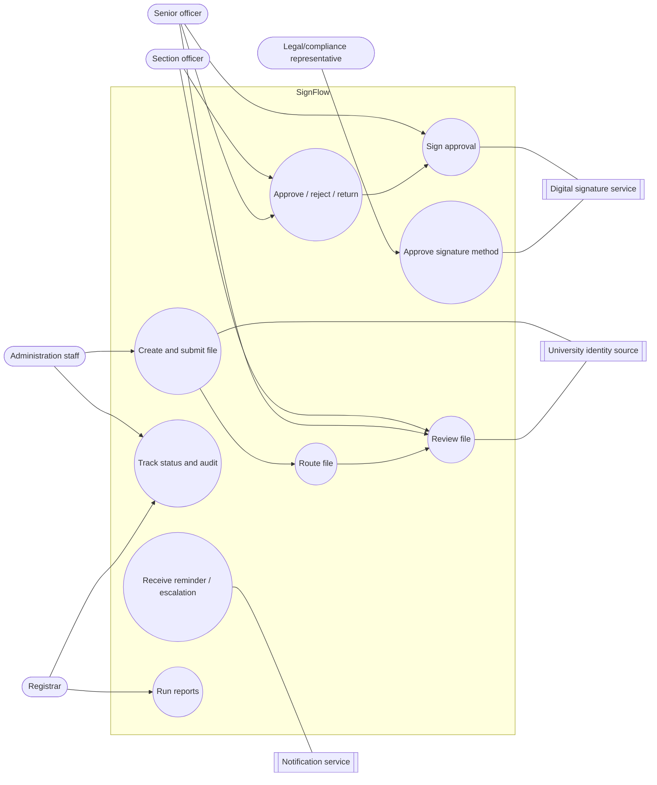
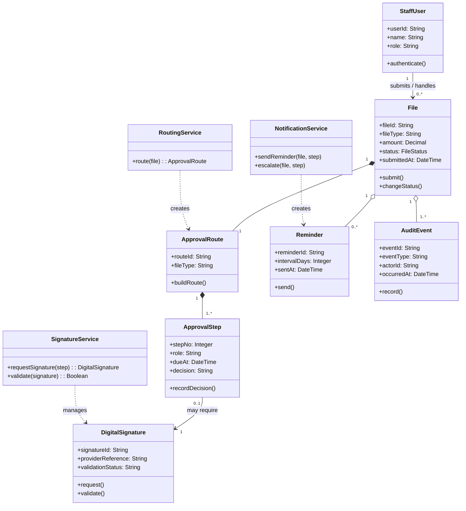
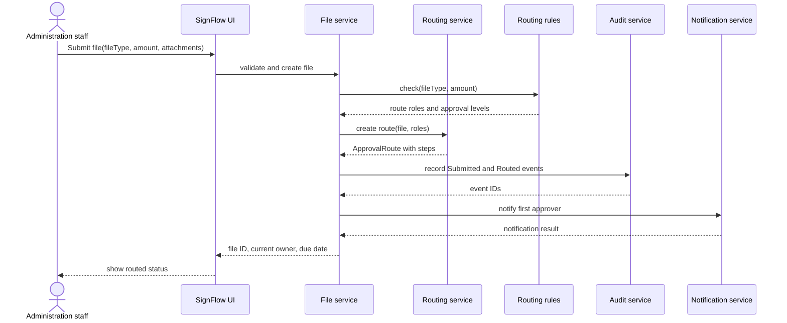
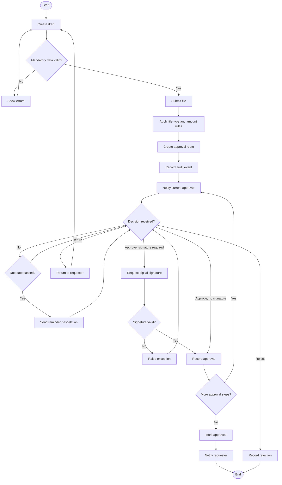
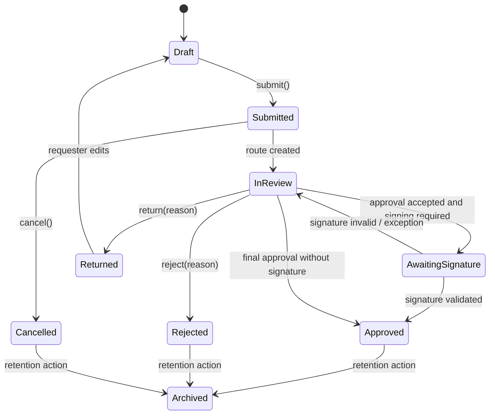

# UML package
## SignFlow — Digital Document Approval Workflow for a University

The diagrams use the same core objects and states throughout: `StaffUser`, `File`, `ApprovalRoute`, `ApprovalStep`, `DigitalSignature`, `Reminder`, and `AuditEvent`. The routing service decides the route; the signature service handles signing and validation.

## 1. Use-case diagram

## 2. Class diagram

## 3. Sequence diagram — route a file for digital approval

## 4. Activity diagram

## 5. State diagram for a file

## 6. Consistency and design justification

### Cohesion

- `RoutingService` contains route selection and route creation rules.
- `SignatureService` contains signature requests and validation results.
- `NotificationService` contains reminders and escalations.
- `AuditService` contains event recording.
- `FileService` owns file lifecycle changes and calls the specialist services.

Each service has one main reason to change. For example, changing the signature provider should not require changes to file-state rules.

### Coupling

Routing and signing communicate through `ApprovalStep` and a signature result. The routing service does not call provider-specific signing functions. The signature service does not decide whether a file is a purchase request or leave request. Their dependency is therefore a small domain interface rather than a shared implementation.

The sequence diagram follows the class diagram: the file service asks the rules component for roles, passes them to the routing service, records audit events, and asks notification service to contact the first approver. The state diagram uses the same approval and signature outcomes shown in the activity diagram.
