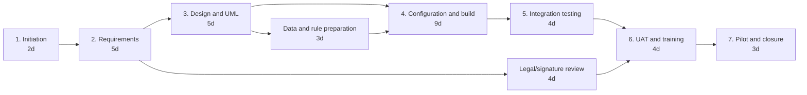

# Project plan
## SignFlow — Digital Document Approval Workflow for a University

## 1. Planning basis

The case gives per-file-type effort of 3 days for workflow design, 4 days for configuration, and 2 days for testing. The schedule below uses **elapsed working days as a planning assumption** so dependencies can be shown. It is not a promise of delivery time. The plan assumes a small team can work on independent activities in parallel and that the university supplies rules and reviewers when needed.

The recommended first release covers purchase requests, leave, and event approvals. These are 1,600 of the 2,000 monthly files, or 80% of volume.

## 2. Work breakdown structure

| WBS | Work package | Main output |
|---|---|---|
| 1.0 | Initiation and governance | Charter, stakeholders, decision log |
| 1.1 | Confirm scope and release boundary | Top-three scope decision |
| 1.2 | Confirm approval owners | Named Registrar, IT, legal, and business owners |
| 2.0 | Requirements | Validated SRS |
| 2.1 | Questionnaires and interviews | Elicitation notes |
| 2.2 | Prototype walkthroughs | Usability and policy feedback |
| 2.3 | FR/NFR and MoSCoW baseline | Requirements baseline |
| 3.0 | Analysis and design | UML package and configured rules |
| 3.1 | Workflow and routing rules | File-type and amount decision rules |
| 3.2 | UML diagrams | Consistent UML package |
| 3.3 | Signature and audit design | Integration and audit design |
| 4.0 | Build/configure | Configured SignFlow release |
| 4.1 | Intake and file record | File creation and validation |
| 4.2 | Routing and inbox | Route and approval steps |
| 4.3 | Signature, reminders, audit | Supporting services |
| 5.0 | Verification | Test evidence and defect log |
| 5.1 | Functional and integration testing | Test results |
| 5.2 | Security, audit, and signature checks | NFR evidence |
| 5.3 | User acceptance testing | Signed UAT result |
| 6.0 | Pilot and closure | Pilot report and closure note |
| 6.1 | Training and assisted onboarding | Training record |
| 6.2 | Pilot launch | Pilot metrics |
| 6.3 | Review, fixes, and release decision | Closure or change plan |

## 3. Network logic and critical path

The following is a dependency network. Durations are planning assumptions in working days.

**Critical path assumption:** A → B → C → D → E → F → G = 2 + 5 + 5 + 9 + 4 + 4 + 3 = **32 working days**. The legal/signature review and data/rule preparation are shown as parallel branches. If either branch takes longer than its successor activity, the critical path must be recalculated.

## 4. Gantt-style schedule

| Activity | Start day | Finish day | Dependency | Milestone/output |
|---|---:|---:|---|---|
| Initiation | 1 | 2 | — | M1: scope decision |
| Requirements | 3 | 7 | Initiation | M2: SRS baseline |
| Design and UML | 8 | 12 | Requirements | M3: design review |
| Legal/signature review | 8 | 11 | Requirements | Signature method decision |
| Data and rule preparation | 13 | 15 | Design | Rules ready |
| Configuration and build | 13 | 21 | Design; rules can overlap after day 12 | M4: configured build |
| Integration testing | 22 | 25 | Build | Test evidence and defects |
| UAT and training | 26 | 29 | Integration testing; legal review | M5: UAT decision |
| Pilot and closure | 30 | 32 | UAT | M6: pilot release/closure |

## 5. Resource allocation assumption

The case does not supply staffing. This indicative allocation shows responsibilities rather than headcount commitments.

| Role | Main allocation | Key approvals |
|---|---|---|
| Registrar | Sponsor and decision owner | Scope, acceptance, escalations |
| IT head / project lead | Planning, architecture, release | Technical design and release |
| Business analyst | Elicitation, SRS, traceability | Requirements baseline |
| Workflow/configuration developer | Rules, screens, integrations | Build readiness |
| QA engineer | Test design, execution, metrics | Test exit recommendation |
| Administration representatives | Process knowledge and UAT | Business acceptance |
| Senior officers | Walkthroughs and UAT | Usability feedback |
| Legal/compliance representative | Signature validity review | Legal approval |

## 6. Monitoring and control

| Phase | Metric | Target | Frequency | Escalation threshold | Corrective action | Approver |
|---|---|---|---|---|---|---|
| Requirements | Baseline completion | 100% Must requirements reviewed | Twice weekly | Any Must requirement without owner at phase exit | Schedule owner workshop; update baseline | Registrar and IT head |
| Design | Rule coverage | All top-three file types have approved routing rules | Weekly | Any type or amount band without a rule | Add rule review and test cases | IT head and business owner |
| Build | Workflow readiness | All Must flows demonstrable | Weekly | Any Must flow blocked at build exit | Reprioritise defects or defer only with approval | IT head |
| Testing | Test pass rate | 100% Must tests pass | Daily during test | Any open critical defect or failed legal/audit test | Stop release; fix and rerun | IT head and QA lead |
| Pilot | Average approval time | Under 4 days | After each reporting period | Average at or above 4 days | Analyse queue and routing; adjust staffing/rules | Registrar |
| Pilot | Lost-file exceptions | Zero | Daily | One unretrievable submitted file | Freeze affected route, restore/reconcile, investigate | IT head and Registrar |

For actual-vs-plan control, record `variance = actual finish day − planned finish day`. A positive value means delay. The phase owner proposes corrective action; the listed approver decides whether to accept a revised date or change scope.
